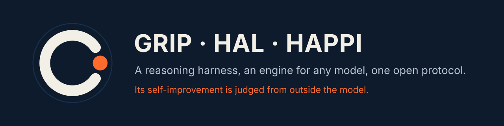

  

**GRIP** is a reasoning harness for AI coding agents. Its safety gates are code, not instructions, so a prompt cannot talk past them. Changes to GRIP are reviewed by models from other AI vendors, and its claims about itself are tested against predictions registered in advance.

**HAL** is the engine underneath. Every AI call goes through one open protocol, **HAPPI**, whichever model answers it, cloud or local, and HAL moves to another provider when one reaches its limit.

| Project | What it is | Licence |
|---|---|---|
| [GRIP](https://github.com/grip-platform/GRIP) | The reasoning harness: safety gates, review councils, signed decision records, memory | AGPL-3.0 |
| [HAL](https://github.com/grip-platform/HAL) | The multi-provider engine and gateway | AGPL-3.0 |
| [HAPPI](https://github.com/CodeTonight-SA/HAPPI) | The open protocol for every AI call ([spec](https://www.happi.md)), with SDKs in [Python](https://github.com/CodeTonight-SA/hal-py), [JavaScript](https://github.com/CodeTonight-SA/hal-js) and [Go](https://github.com/CodeTonight-SA/hal-go) and a [conformance suite](https://github.com/CodeTonight-SA/hal-conformance) | Apache-2.0 |
| [GRASP](https://github.com/CodeTonight-SA/grasp) | Tamper-evident records of what an AI decided, what it believed and what it claimed | AGPL-3.0 |

### Check it yourself

- Open the [GRASP verifier](https://grasp.codetonight.co.za), edit any recorded decision, and watch the break ripple down every later record.
- Run the [HAPPI conformance suite](https://github.com/CodeTonight-SA/hal-conformance) against any implementation of the protocol.

### What a seal does not prove

A signed record proves that nobody changed it after it was written. It does not prove that the decision was right.

© 2026 V>> • Lourens Cornelius Scheepers · CodeTonight (Pty) Ltd · [codetonight.co.za](https://codetonight.co.za)
